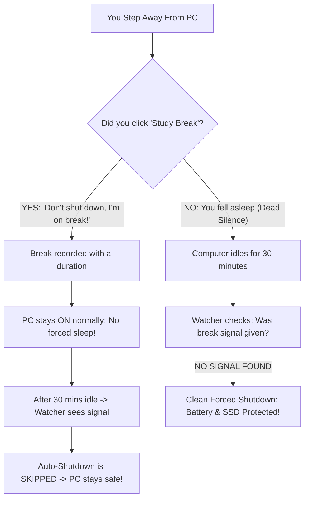

<p align="center">
  <picture>
    <source media="(prefers-color-scheme: dark)" srcset="assets/wordmark-dark.svg">
    <source media="(prefers-color-scheme: light)" srcset="assets/wordmark-light.svg">
    
  </picture>
</p>

<h1 align="center">NightWatch</h1>
<p align="center">A study-break sentinel for Windows 11. It shuts the PC down when you fall asleep at the keyboard.</p>

<p align="center">
  <a href="https://microsoft.com"></a>
  <a href="https://github.com/PowerShell/PowerShell"></a>
  <a href="LICENSE"></a>
  <a href="https://github.com/OFFICIAL-ZXKTS/NightWatch"></a>
</p>

<p align="center">
  <b>Wake up to a laptop that still has battery left.</b><br>
  NightWatch tells an intentional break apart from falling asleep at the keyboard.
</p>

<p align="center">
  <a href="#-key-features">Key Features</a> •
  <a href="#-how-it-works">How It Works</a> •
  <a href="#-quick-installation">Quick Installation</a> •
  <a href="#-usage">Usage</a> •
  <a href="#-custom-desktop-icon">Desktop Icon</a> •
  <a href="#-frequently-asked-questions">FAQ</a> •
  <a href="#-uninstallation">Uninstallation</a>
</p>

---

## 📦 v0.1 — what is in this release

The first tagged release. Everything below is in it.

**The sentinel no longer shuts the PC down on you.**
`GetLastInputInfo` cannot see input on the Winlogon secure desktop, so
unlocking the screen and logging in never reset the idle counter. The counter
kept running while you were actually back at the machine, and the alarm fired
seconds after an unlock — the PC powered off while the user was standing in
front of it. NightWatch now tracks idle time itself and restarts the clock
the moment it can prove you are back. Unlocking the screen during the alarm
cancels the shutdown.

**The warning is audible.**
A laptop in Modern Standby (lid closed, screen timed out) suspends its audio
endpoint, so the tone was dropped: the alarm ran, the log recorded it, and the
PC shut down in silence. The alarm now holds the system and the display awake
for its whole run.

**The UI moved into a compiled library.**
`NWCore.cs` holds the custom-drawn controls *and* the layout that assembles
them into the three dialogs; `StudyBreak.ps1` is a thin launcher. Building a
dialog in PowerShell cost about 420 ms. It now costs about 40 ms, and the app
opens in roughly half the time.

**The interface.**
The real NightWatch artwork in the header and the title bar, a black and
orange palette, and windows sized to their content so the action buttons are
never clipped — at any display scaling, because the height is measured from
the text rather than guessed.

**Other fixes.**
`bcdedit` now applies the boot-status policy to every boot entry and reports
its real output, instead of silently failing on `{default}`. The idle-time
state is persisted so the sentinel's clock survives a restart. `Test-IdleResolution.ps1`
covers the idle rules; `StudyBreak.ps1 -SelfTest` covers the dialogs.

---

## ⚡ What NightWatch does

NightWatch watches one thing: whether you are still at the keyboard.

| Your Action | What NightWatch sees | What Happens |
| :--- | :--- | :--- |
| 🟢 **You Click the Button** (or press `Ctrl+Alt+B`) | An intentional break is active | Sends the break signal. The 30-minute auto-shutdown is **paused**, so your downloads and music keep running. |
| 🔴 **You Do NOTHING** (Accidentally fell asleep) | No break signal, and 30 minutes idle | The background watcher **executes a clean forced shutdown** to protect your battery and SSD. |

---

## 🎯 What goes wrong without it

Working late, you run into two situations:
1. **If you step away for a break**: You want the 30-minute idle shutdown to stay off, so your open tabs, background tasks and downloads keep running.
2. **If you accidentally fall asleep**: You don't want your laptop/PC burning all night on your bed or desk, draining battery cycles, overheating, and wearing out hardware.

**NightWatch covers both.**



---

## ✨ Key Features

- **🎯 True 30-Minute Physical Idle Tracking**: Uses Win32 `GetLastInputInfo` to measure exact keyboard and mouse idle time, so a dimming screen no longer triggers a premature shutdown.
- **🔄 The Clock Resets When You Come Back**: Unlocking the screen and logging in are *secure-desktop* input, and `GetLastInputInfo` cannot see it — so the counter kept running while you were actually back at the machine, and the PC could shut down seconds after you unlocked it. NightWatch now tracks the idle time itself and restarts the clock the moment it can prove you are back.
- **🔊 30-Second Warning Beep Countdown**: Plays audible warning beeps before shutting down. Moving the mouse, tapping any key, or unlocking the screen during the beeps instantly aborts the shutdown. The alarm holds the system and the display awake while it runs, so the tone is never swallowed by a suspended audio device (lid closed / screen timed out).
- **🎨 The Real NightWatch Icon**: The header shows the actual artwork from `assets/icon.png`, the same picture the Desktop shortcut uses, and the window carries the real icon in its title bar. The finished tile is cached next to the compiled library, so it costs a couple of milliseconds per launch instead of decoding an 818×818 PNG every time.
- **⏱️ Timed Breaks That End Themselves**: Press **`Ctrl + Alt + B`** (or double-click the icon) and a dialog asks how long your break lasts — pick **15 / 30 / 40 / 60 min** or type any custom value. Auto-shutdown stays paused for exactly that long, then arms itself again. You never have to click again to turn it off.
- **🔁 Boot-Session Aware Breaks**: Every break is stamped with the current OS boot session. **Restarting or shutting down the PC cancels the break** (a break can't survive a reboot you didn't plan), while **sleep and hibernate preserve it**, since those keep the same boot session.
- **🛡️ Accidental Sleep Defense**: If you truly fall asleep with no break active, NightWatch executes a clean forced shutdown (`shutdown /s /f /t 0`) to protect your battery and SSD.
- **🔇 Boot Beep Suppression**: If a shutdown is ever flagged as unsuccessful, Windows plays a short beep at the next boot and offers the recovery menu. The installer sets `bootstatuspolicy ignoreallfailures` and `recoveryenabled no` on every Windows Boot Loader entry so that neither happens — whatever caused the flag. Every `bcdedit` command's real output is printed and the setting is read back afterwards, so a silent failure is not possible.
- **🔒 No Desktop Writes**: All break state lives in `C:\ProgramData\NightWatch\break_state.json`, so the sentinel never modifies Desktop files and cannot trigger icon refresh or flicker.
- **🔋 Full Battery & AC Support**: Configured to run whether on laptop battery or plugged into wall power.
- **⚙️ Runs in the background**: Elevated and launched by `SilentRunner.vbs`, so there is no console window, no focus stealing and no desktop flicker.

---

## 📦 Project Structure

```text
NightWatch/
├── assets/
│   ├── wordmark-dark.svg       # 3D ANSI shadow typography wordmark (dark mode)
│   ├── wordmark-light.svg      # 3D ANSI shadow typography wordmark (light mode)
│   ├── icon.ico                # Multi-resolution desktop shortcut icon
│   └── icon.png                # The artwork behind the icon
├── NWCore.cs                  # The UI library: custom controls + the three dialogs
├── StudyBreak.ps1              # Launcher: loads NWCore.cs, handles the break state
├── StudyBreak.bat              # Standalone batch launcher
├── IdleMistakeDetector.ps1     # 30-minute idle watcher & safety shutdown engine
├── SilentRunner.vbs            # Zero-window invisible launcher for Task Scheduler
├── Install-StudySafetySystem.ps1 # Automated installer (configures Task Scheduler & custom icon)
├── Reinstall.bat               # 1-click self-elevating reinstaller
├── Uninstall-StudySafetySystem.ps1 # One-click removal script
├── LICENSE                     # Official Apache 2.0 License
└── README.md                   # Documentation
```

---

## 🎨 Custom Desktop Icon

NightWatch includes a custom-designed 3D app icon for your Desktop shortcut:

<div align="center">
  <br>
  <sub><b>assets/icon.ico</b> (256x256 high-resolution Windows icon)</sub>
</div>

### How the icon is applied:
- **Automatic:** Running `Install-StudySafetySystem.ps1` or double-clicking `Reinstall.bat` automatically binds `assets\icon.ico` to your Desktop shortcut!
- **Manual (Optional):**
  1. Right-click the **Study Break** shortcut on your Desktop $\rightarrow$ select **Properties**.
  2. Under the **Shortcut** tab, click **Change Icon...**.
  3. Click **Browse...** $\rightarrow$ choose `assets\icon.ico` from your NightWatch folder.
  4. Click **OK** $\rightarrow$ **Apply**.

---

## 🚀 Quick Installation

### Option 1: Automated 1-Command Setup (Recommended)

1. Clone or download this repository.
2. Open **PowerShell as Administrator** (`Win + X` $\rightarrow$ **Terminal (Admin)**).
3. Navigate to your NightWatch folder and run:

```powershell
Set-ExecutionPolicy -Scope Process -ExecutionPolicy Bypass
.\Install-StudySafetySystem.ps1
```

The installer will automatically:
- Enable Windows Deep Hibernation (`powercfg /hibernate on`).
- Suppress the dirty-boot beep with `bcdedit /set {default} bootstatuspolicy IgnoreAllFailures` so forced shutdowns never trigger a beep at next boot.
- Create your **Study Break** Desktop icon with the custom 3D icon and `Ctrl + Alt + B` hotkey.
- Register the 30-minute idle detector in Windows Task Scheduler with full battery support and 100% silent execution.

---

### Option 2: Manual Setup via Windows Task Scheduler

<details>
<summary>Click to view manual step-by-step instructions</summary>

1. **Enable Hibernation**:
   In an *Administrator* PowerShell or cmd: `powercfg /hibernate on`
2. **Create the Desktop Shortcut**:
   - Right-click Desktop $\rightarrow$ **New** $\rightarrow$ **Shortcut**.
   - Location: `powershell.exe -NoProfile -ExecutionPolicy Bypass -WindowStyle Hidden -File "<full path to your NightWatch folder>\StudyBreak.ps1"`
   - (Optional) set *Change Icon* to `assets\icon.ico`.
   - Name the shortcut `Study Break`.
3. **Register the scheduled task**:
   - Open `taskschd.msc` $\rightarrow$ **Create Task...** (not "Create Basic Task").
   - **General** tab:
     - **Name**: `NightWatchSentinel`
     - Select *Run only when user is logged on*
     - Check *Run with highest privileges*
   - **Triggers** tab $\rightarrow$ **New...**:
     - Begin the task: *On a schedule* $\rightarrow$ *Daily*
     - **Advanced settings**: check *Repeat task every:* `2 minutes`, for a *duration of:* `Indefinitely`.
   - **Actions** tab $\rightarrow$ **New...**:
     - Action: *Start a program*
     - Program/script: `wscript.exe`
     - Add arguments: `"<full path to the folder you extracted NightWatch into>\SilentRunner.vbs"` (for example `"E:\Shutdown\SilentRunner.vbs"`)
   - **Conditions** tab:
     - **Uncheck** *Start the task only if the computer is on AC power* (ensures protection works on battery).
   - Click **OK**.

</details>

---

## 🎮 Usage

### Scenario A: Taking an Intentional Break
1. When you step away from your desk, do either:
   - **Double-click** the **Study Break** desktop shortcut, OR
   - Press **`Ctrl + Alt + B`** on your keyboard.
2. A **duration dialog** appears *before* anything is enabled. Choose a preset
   (**15 / 30 / 40 / 60 min**) or type a custom number of minutes.
3. Click **Start**. A confirmation shows the exact time your break ends.
4. Your PC stays ON normally with no forced sleep. The background watcher sees
   the active break and skips shutdown for the whole duration.
5. **Nothing else to do.** When the duration elapses, the break turns itself
   **OFF** and the 30-minute idle protection is armed again automatically.
6. If you return early and want protection back sooner, press the button again.
   A dialog shows the break's end time and remaining minutes, with two choices:
   **End break now** (re-arms protection immediately) or **Keep break** (let it
   finish on its own). Nothing changes unless you pick one.

### Scenario B: Accidentally Falling Asleep
1. You fall asleep while studying without hitting the break button.
2. After **30 minutes of no mouse/keyboard activity**, the background watcher runs.
3. It detects that no intentional break signal exists.
4. It sounds a **30-second warning beep countdown**. Touching the mouse or keyboard cancels it immediately.
5. If ignored for 30 seconds, it performs a clean, forced shutdown to protect your battery and hardware.

   Touching the mouse, tapping a key, or unlocking the screen during the
   countdown cancels it immediately — NightWatch never powers off a machine
   you are standing in front of.

---

## ⏱️ How Breaks Expire

A break is only honoured while **both** of these are true:

| Rule | Behaviour | Why |
| :--- | :--- | :--- |
| **Duration not elapsed** | Break clears itself once your chosen minutes are up | You never have to remember to switch it off |
| **Same boot session** | A break is discarded if the PC was restarted or shut down | You can't be "on break" across a shutdown you didn't plan |
| **Sleep / hibernate** | Break is **kept** | These don't end the boot session, so a break still counts |

How it detects this: each break records the OS uptime in milliseconds at the
moment you start it (`BootUptimeMs`). Uptime resets to near zero on a real
restart or shutdown, but keeps climbing through sleep and hibernate. So if the
stored uptime is *higher* than the current uptime, a reboot must have happened
in between and the break is stale.

> **Note:** a break is not cancelled by restarting the PC — it is *discarded*,
> which is the same practical effect. Your idle protection returns to normal
> after the next reboot, with no manual cleanup required.

### Nothing touches your Desktop

Break state lives entirely in `C:\ProgramData\NightWatch\break_state.json`.
Earlier versions dropped a `break_marker.txt` on the Desktop; that is gone, so
the sentinel no longer modifies Desktop files and cannot trigger a desktop
icon refresh or flicker.

---

## 🔇 Boot Beep

If a shutdown is ever flagged as unsuccessful, Windows plays a short beep at the
next boot while `wininit.exe` offers the recovery menu.

The installer now applies the settings to **every** Windows Boot Loader entry,
not just `{default}` — `bcdedit` rejects an identifier it does not know, and
the old installer only ever tried `{default}`, so the setting could fail
silently:

```powershell
bcdedit /set {current} bootstatuspolicy ignoreallfailures
bcdedit /set {current} recoveryenabled no
```

Every `bcdedit` command's real output is printed, and the value is read back
with `bcdedit /enum {current}` afterwards, so you can always confirm it took
effect.

> **Note:** on this machine the last forced shutdown was recorded by Windows as
> *successful* (`Kernel-Boot` event 20), so no boot beep came from that
> mechanism. If you hear a beep right after a restart, it is the NightWatch
> warning alarm starting again — which v4.0 fixes; see below.

---

## ⏱️ Startup Time

Opening the break dialog takes about **0.8 seconds**, down from **1.2 seconds**
before the UI moved into the compiled library. Both numbers were measured on
this machine by launching the app and timing how long until the window was on
screen — eight runs each, from the same warm state.

| Stage | Cost | Can it go? |
| :--- | ---: | :--- |
| PowerShell host start (`-NoProfile -STA`) | ~240 ms | No — it is a `.ps1` |
| Loading `System.Windows.Forms` + the compiled `NW.Core` library | ~165 ms | No |
| First WinForms control (theme + metrics init) | ~120 ms | No — one-time per process |
| **Building the form** | **~40 ms** | It was ~420 ms before the port |
| First paint | ~90 ms | Partly |

The form build was the one movable piece. A dialog of this size takes about
40 ms to build from plain WinForms controls, and about 40 ms to build in C#.
The old version took ~420 ms, because PowerShell had to create every control
and every table cell through its own adapter at run time.

That is why `NWCore.cs` exists. The custom-drawn controls and the layout that
assembles them into the three dialogs both live there now, and `StudyBreak.ps1`
is a thin launcher: it loads the compiled library, handles the break state and
shows the dialog.

> **A note on how this was measured.** An earlier reading of "2–3 seconds"
> turned out to be Windows Defender re-scanning `StudyBreak.ps1` right after
> the file had been edited, not the app being slow. The old build and the new
> one were then benchmarked side by side, from the same warm state, so the
> numbers above compare like with like.

---
## 🔊 The Warning Alarm

The alarm is what you are meant to wake up to, so it is worth knowing exactly
how it behaves.

### Why the PC used to shut down in silence

Windows puts a laptop into **Modern Standby** when the lid closes or the
screen times out. In that state the audio endpoint is suspended, so a tone
played into it is silently dropped — the alarm ran, the log recorded it, and
the PC shut down anyway with no sound at all.

v4.0 fixes this by holding the system and the display awake
(`SetThreadExecutionState`) for the whole alarm, and by giving the audio
pipeline a moment to come back up before the first tone.

### Why the PC used to shut down the moment you came back

`GetLastInputInfo` only reports input delivered to the session's **normal**
desktop. Input on the **Winlogon secure desktop** — unlocking the screen,
logging in, dismissing a UAC prompt — is invisible to it.

That produced this sequence, which is visible in the system event log:

```text
07:20:11  Kernel-Power: SessionUnlock          <- you come back and unlock
07:20:54  NightWatch: ACCIDENTAL SLEEP          <- the counter never reset
07:21:16  Kernel-Power: shutdown initiated      <- the PC powers off on you
```

The same blind spot applied to the **login** screen, which is why the idle
counter effectively started at *boot* after a restart — the alarm could start
beeping again while you were already sitting at the machine.

v4.0 tracks the idle time itself in `C:\ProgramData\NightWatch\idle_state.json`
and restarts the clock whenever it can prove you are present:

| Signal | What NightWatch does |
| :--- | :--- |
| The session was locked and is now unlocked | You came back — restart the 30-minute clock |
| The PC rebooted since the last check | The login input was never counted — restart the clock |
| The Win32 counter moved backwards | Real keyboard/mouse activity — restart the clock |
| The session is locked and stays locked | You are away — keep counting, and shut down after 30 minutes |

Unlocking the screen *during* the alarm also cancels it. NightWatch will never
power off a machine you are standing in front of.

### Check that the alarm can be heard

```powershell
powershell -NoProfile -ExecutionPolicy Bypass -File ".\IdleMistakeDetector.ps1" -Test
```

This prints what the sentinel sees (session state, idle time, break status),
plays the warning tone once, and reports how many tones were actually pushed
to the audio device. It never shuts anything down.

Add `-DryRun` to run the full detection logic — including the alarm — while
guaranteeing the machine is never powered off.

---

## ⚙️ Customization

Want to change the idle duration (e.g. to 20 or 45 minutes)?

The 30-minute idle threshold is set directly in `IdleMistakeDetector.ps1`:

```powershell
$targetIdleSeconds = 1800   # 30 minutes
```

1. Open `IdleMistakeDetector.ps1` in any text editor (Notepad, VS Code, etc.).
2. Change `1800` to your preferred value in seconds:
   - `1200` = 20 minutes
   - `2700` = 45 minutes
   - `3600` = 1 hour
3. Save the file.
4. Double-click `Reinstall.bat` so the change takes effect.

---

## ❓ Frequently Asked Questions

#### Q: Do I need to double-click the shortcut?
**A:** Yes, like standard Windows desktop shortcuts, it opens with a double-click. **Pro Tip:** You can also press **`Ctrl + Alt + B`** from anywhere, or right-click the shortcut and select **Pin to Taskbar** for a single-click button!

#### Q: Why Hibernate instead of Sleep?
**A:** Standard Sleep continues drawing battery to keep RAM active (wasting 15%–30% overnight and keeping the laptop warm in a backpack). Hibernate dumps RAM state directly to your SSD and drops power consumption to **absolute zero**.

#### Q: My PC beeps once at boot. Is that NightWatch?
**A:** Two different things can beep at boot. Windows itself plays a short beep when a shutdown is flagged as unsuccessful — the installer suppresses that with `bootstatuspolicy ignoreallfailures` and `recoveryenabled no`, applied to every boot entry. If what you hear is instead the *NightWatch warning alarm*, that is the idle detector reaching 30 minutes; v4.0 stops it from starting up on its own right after a restart. Run `.\IdleMistakeDetector.ps1 -Test` to see exactly what the sentinel sees, and `.\IdleMistakeDetector.ps1 -DryRun` to watch it decide without it ever powering the machine off.

#### Q: Will this close my unsaved files if I fall asleep?
**A:** If you fall asleep without hitting the break button, it executes `shutdown /s /f /t 0` to preserve the hardware. We strongly recommend using browser session restore (Chrome/Edge $\rightarrow$ *"Continue where you left off"*) and Auto-Save in your text editors (VS Code, Word, etc.).

---

## 🗑️ Uninstallation

To cleanly remove the shortcut and scheduled task:
1. Open **PowerShell as Administrator**.
2. Navigate to your repository folder.
3. Run:
```powershell
.\Uninstall-StudySafetySystem.ps1
```

> The `bcdedit` boot-status-policy change is **not** reverted by uninstall. If
> you want to restore the default behaviour, run
> `bcdedit /deletevalue {default} bootstatuspolicy` from an elevated prompt.

---

## 📄 License

Distributed under the **[Apache License 2.0](LICENSE)**. Includes patent grants, contributor terms, and trademark protection. Free for personal and commercial use.
